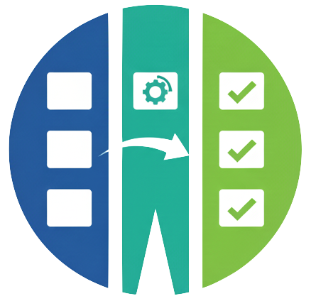
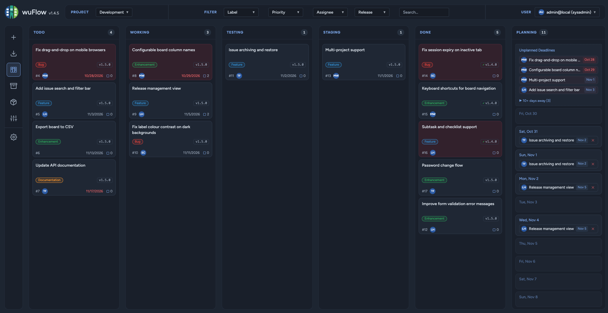

# wuFlow

**Keep your work flowing.** wuFlow is a lean, security-first, self-hosted issue tracker: Kanban board, backlog, releases and a daily planner in one place. Open source, no subscription, no tracking.

[Website](https://wuflow.dev) · [Documentation](https://github.com/pwurbs/wuflow/wiki) · [Releases](https://github.com/pwurbs/wuflow/releases)

[](https://github.com/pwurbs/wuflow/releases)
[](https://opensource.org/licenses/Apache-2.0)
[](https://artifacthub.io/packages/search?repo=wuflow)
[](https://sonarcloud.io/dashboard?id=wuflow-oss)
[](https://sonarcloud.io/dashboard?id=wuflow-oss)



## Why another board?
Kanban has been my tool of choice for years, in professional DevOps teams and agile projects. I learned agile work with Jira, and its core features are excellent: boards, backlog, releases. When Atlassian ended its server licences, I wanted to keep exactly these features, self-hosted, but in a different package: lean, focused and secure.

I tested the self-hosted alternatives in depth ([full comparison on Medium](https://medium.com/@pwurbs/beyond-jira-reclaiming-agile-sovereignty-with-open-source-14556d709c65)). None of them quite fit. So I started wuFlow: a clean, modern interface on a sovereign, self-hosted agile engine, built around four requirements:

- **A real agile core**: releases, a proper backlog and structured planning, not just a simple card board.
- **Lean and secure**: core features only, security by design, a minimal supply chain, strict security headers and careful token handling.
- **Daily planning built in**: a classic Kanban workflow and flexible day-by-day planning, side by side.
- **Open and sovereign**: 100% open source, running on your own infrastructure, even air-gapped. No cloud lock-in, no calling home.

wuFlow doesn't aim to replace the established tools for everyone. It is for anyone who wants the agile core without the overhead: dev teams, project groups, clubs and families.

## Features
**Plan**
- **Board and planner side by side**: your Kanban columns and a day-by-day plan in one view, so no deadline slips through.
- **Backlog**: sort upcoming work and assign it to releases.
- **Releases**: named, time-boxed releases with an owner and a progress bar. Publish them to close and archive done issues.

**Track**
- **Subtasks and deadlines**: break big issues into checklists, each item with its own due date.
- **Complete history**: every change to status, fields and tasks is recorded automatically.
- **Labels and filters**: colour-coded labels per project. Filter by label, priority or assignee, or search the text.
- **Archive**: move finished issues out of the way and keep them for reference.

**Collaborate**
- **Projects**: separate teams or topics, each with its own configurable board columns and labels.
- **Assign and prioritise**: give every issue an owner, flag high-priority work and set the order of cards in each column.
- **Users and roles**: built-in user management. Several people can edit the same issue safely.
- **Markdown everywhere**: write descriptions with a built-in editor and live preview, and discuss in Markdown comments.

## Supply chain
Flaws like Log4Shell and React2Shell and attacks like the polyfill.io takeover and the XZ Utils backdoor showed it clearly: every dependency is a potential liability. wuFlow keeps its runtime radically small:

```
wuflow                  Go binary, frontend assets embedded
├─ golang-jwt/jwt       Go: session tokens
├─ mattn/go-sqlite3     Go: embedded SQLite database
├─ golang.org/x/crypto  Go: password hashing
├─ dompurify            JS: Markdown sanitisation, pinned and bundled
└─ marked               JS: Markdown rendering, pinned and bundled
```

Everything else is the Go standard library and vanilla JavaScript, without heavy frameworks. DOMPurify and marked were chosen on purpose: for Markdown rendering and sanitisation, years of community scrutiny count more than a home-grown solution. Vite bundles the frontend at build time. Nothing is loaded from outside at runtime, and no external services are needed.

## Get started
Try wuFlow locally with Docker (images for linux/amd64 and linux/arm64):

```bash
docker run -p 8080:8080 \
  -e WF_INITIAL_ADMIN_PASSWORD="change-me-to-something-long" \
  -e WF_SECURE_COOKIE=false \
  -v wuflow-data:/data \
  ghcr.io/pwurbs/wuflow:<version>
```

Replace `<version>` with the newest tag in the [image repository](https://github.com/pwurbs/wuflow/pkgs/container/wuflow). There is no `latest` tag. Then open `http://localhost:8080` and log in as `admin@local` with the given password. This password must meet the [password policy](docs/user-management.md#password-policy), otherwise the app doesn't start.

Data is stored in an embedded SQLite database in the `/data` volume. PostgreSQL support is planned.

Deployment options, described in [Deployment](docs/deployment.md#deployment-options):
- Docker: for quick tests and simple setups.
- Kubernetes (Helm): for production use.
- Home Assistant: for private use at home.

## Building from source
You need Go, a C compiler (the SQLite driver uses cgo) and Node.js 24+. Clone the repository, then:

```bash
# Build the frontend into static/dist/app (the binary embeds it, so repeat after changing static/)
cd static/js
npm ci
npm run build
cd ../..

# Build the binary
go build -o wuflow .

# Start it
./wuflow -initial-admin-password "change-me-to-something-long" -secure-cookie=false
```

## Configuration
wuFlow is configured with environment variables or command-line flags. [Configuration](docs/configuration.md) lists all options. The most important ones:
- `WF_INITIAL_ADMIN_PASSWORD`: password of the first admin (`admin@local`), required on the first start.
- `WF_SECRET_KEY`: a stable random key of at least 32 characters. Without it, all users are logged out on every restart.
- `WF_REMOTE_IP_HEADER`: the header with the client IP when running behind a reverse proxy.

> **Run wuFlow behind a TLS-terminating reverse proxy and keep Secure Cookie enabled.**
> wuFlow serves plain HTTP. The Secure flag keeps the auth cookies off unencrypted connections, and it only works when a reverse proxy in front of wuFlow handles TLS. Set `WF_SECURE_COOKIE=false` only for local tests or internal, trustworthy HTTP networks. See [Reverse proxy](docs/deployment.md#reverse-proxy) for proxy setup, client IP and compression.

## Usage Guide
Please refer to the [Usage Guide](docs/usage-guide.md) for a brief overview on how to navigate the app, manage issues, and use the Kanban board.

## Documentation
Technical details, architecture and functional descriptions are in the [`docs/`](docs/) folder:

- Operation: [Deployment](docs/deployment.md), [Configuration](docs/configuration.md), [Helm chart](chart/README.md), [Home Assistant add-on](home-assistant-addon/README.md)
- API: [API Design](docs/api.md), [Swagger](docs/swagger.json)
- Architecture: [Backend](docs/backend-architecture.md), [Frontend](docs/frontend.md), [Concurrency Control](docs/concurrency-control.md), [Testing](docs/testing.md)
- Security: [Security Guidelines](docs/security-guidelines.md), [User Management](docs/user-management.md), [Client Security](docs/client-security.md), [Input Validation](docs/input-validation.md), [Markdown Security](docs/markdown-security.md)

## Roadmap
wuFlow is in its early stages. Planned next:
- Dependencies between issues
- Links between issues
- Light mode
- Private issues
- PostgreSQL support
- Horizontal scaling
- OIDC single sign-on
- Project-scoped roles
- File uploads
- Prometheus metrics

## Feedback
Found a bug or have an idea? [Open an issue](https://github.com/pwurbs/wuflow/issues).

## License
[Apache 2.0](LICENSE)
